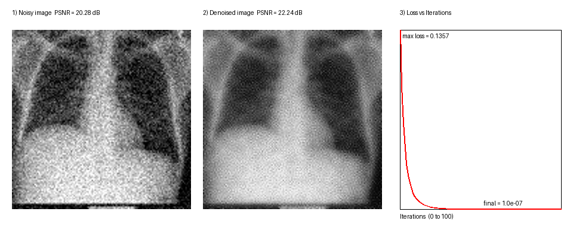

# Medical Image Denoising using Gradient Descent

Denoising a chest X-ray by treating it as a **numerical optimization problem**, with Gradient Descent written from scratch in plain Python (loops and lists, no NumPy / OpenCV / Matplotlib). Pillow is used only to open and save the image.



## Idea
Noise appears as tiny random jumps between neighbouring pixels. I minimize the energy

```
E(X) = 1/2 * sum (X - Y)^2  +  (lambda/2) * sum (Gx^2 + Gy^2)
```

- `Y` = noisy image, `X` = image being optimized
- `Gx, Gy` = Sobel gradients of `X`
- first term: stay close to the noisy image; second term: keep neighbouring jumps small

Gradient of the energy: `grad E = (X - Y) + lambda * Sobel^T(Gx, Gy)`

Update rule applied to every pixel:

```
X_new = X_old - alpha * grad E
```

## Results (100 iterations, alpha = 0.1, lambda = 3)
| Metric | Value |
|---|---|
| Loss (mean abs gradient) | 0.136 -> about 1e-7 |
| PSNR | 20.28 dB -> 22.24 dB (+1.95 dB) |

The loss decreases smoothly with no oscillation, which shows convergence.

## Run it
```
pip install pillow
python medical_denoising.py
```
Put your image next to the script as `xray.jpg`. The program prints the loss every 10 iterations and saves `medical_denoising_results.png`.

## Files
- `medical_denoising.py` - full implementation
- `xray.jpg` - input image
- `medical_denoising_results.png` - noisy image, denoised image and loss graph

## Dataset
NIH Chest X-ray Dataset (ChestX-ray14), NIH Clinical Center: https://nihcc.app.box.com/v/ChestXray-NIHCC

## Possible improvements
Adam / momentum for faster convergence, Total Variation regularization to keep edges sharp, extension to CT and MRI.
